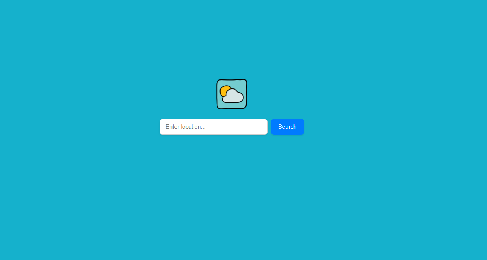

# Weather-Web-App

Simple, clean, and fast Weather Web App using the Visual Crossing Weather API.

Sample solution for the [Weather App](https://roadmap.sh/projects/weather-app) challenge from [roadmap.sh](https://roadmap.sh).

- **Project URL:** https://roadmap.sh/projects/weather-app
- **GitHub Repository:** https://github.com/matteobertasaa/Weather-Web-App
- **Link demo website:** https://matteobertasaa.github.io/Weather-Web-App/

## Interface



## Project Structure

```text
Weather-Web-App
     ├── .env.example      # File to copy to create the .env file
     ├── .gitignore        
     ├── favicon/
     │   └── icons8-weather-96.png
     ├── Interfaccia/
     │   └── image.png
     ├── index.html      
     ├── README.md       
     └── style.css         
```

## Security and API Key Configuration

For security reasons, the API key is not included in the source code.

### How to configure the key:
1. Create a file named `.env` in the root folder (you can just copy the `.env.example` file).
2. Insert your Visual Crossing API key:
   In the newly created `.env` file, add the following line (you can obtain a key by registering on their website):
   `API_KEY=your_api_key_here`

## How to run the project

1. Download the project by running `git clone https://github.com/matteobertasaa/Weather-Web-App.git` or by downloading the .ZIP file.
2. Open the project folder in VS Code.
3. Configure the `.env` file following the instructions above.
4. Use the **Live Server** extension to launch and view the project in your browser. (Note: The app will also prompt you for the API key if it cannot read the `.env` file).
